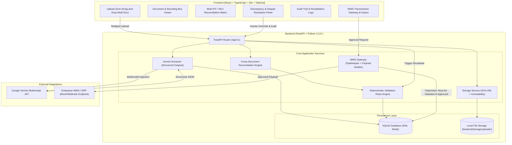
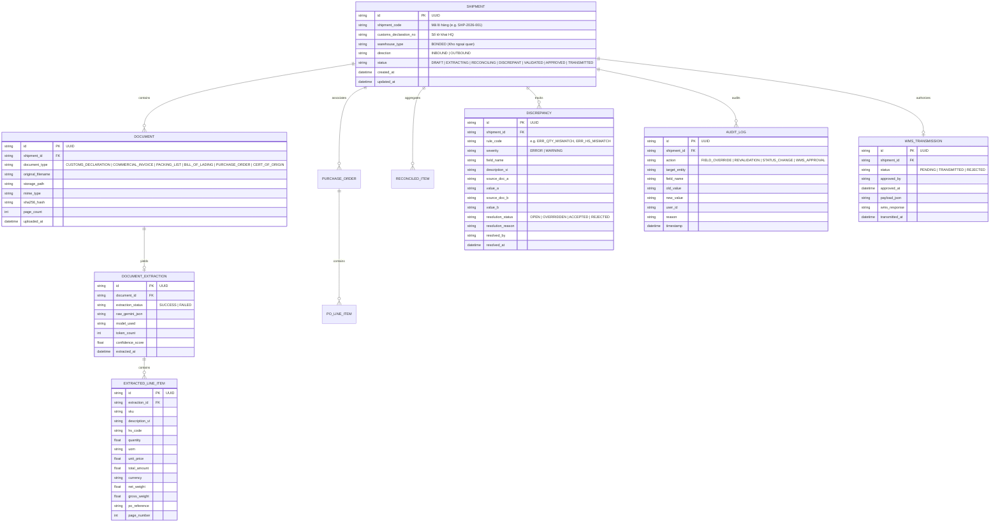

# Current user-approved scope — 2026-10-11

This section supersedes conflicting historical business requirements below. The current demo requires exactly three categories: COMMERCIAL_INVOICE, PACKING_LIST, WAREHOUSE_CONTRACT. Customs declarations and bills of lading are optional and are not required to approve/export. Validate the lease number, tenant, lessor, warehouse, validity dates, tenant vs Invoice/PL consignee and explicit shipment entry_date. Reconcile by PO plus SKU and sum repeated lines. Do not waive still-failing checks through acceptance notes. Only verified, human-approved data may export. AI extracts; deterministic code decides validity.

The user removed the discrepancy chatbot, benchmark feature, and technical introduction/roadmap pages. Prepare deployment, but do not publish yet. Future public demo has anonymous link access and only synthetic sample uploads. Preserve existing local records and keys. Keep all remaining technical invariants below unless overridden by this scope.

---
# AGENTS.md — System Architecture, Governance & Development Guidelines

> **Project**: Vietnamese Bonded Warehouse AI Document Processing Web Application (*Hệ thống AI Xử lý Chứng từ Kho Ngoại Quan*)  
> **Target Audience**: AI Agents (Antigravity, Cursor, Claude Code, GitHub Copilot) and Human Software Engineers  
> **Environment**: Windows 10 Localhost / Modern Web  
> **Tech Stack**: React, TypeScript, Vite, Tailwind CSS, FastAPI, SQLite, SQLAlchemy, Google Gemini API  

---

## 1. Executive Summary & Purpose

This system is an academic research and enterprise-grade demonstrator for **automated processing, OCR/multimodal extraction, cross-document reconciliation, deterministic validation, and WMS gatekeeping** for bonded warehouse logistics (*kho ngoại quan*) in Vietnam.

Bonded warehouses operate under strict customs oversight (Decree 08/2015/NĐ-CP, Circular 38/2015/TT-BTC, and Circular 39/2018/TT-BTC of the Ministry of Finance / General Department of Vietnam Customs). A single inbound or outbound shipment (*lô hàng*) requires multiple cross-referencing documents:
- **Tờ khai hải quan (Customs Declaration - VNACCS)**: Form HQ/2015/NK (Inbound) or HQ/2015/XK (Outbound)
- **Hóa đơn thương mại (Commercial Invoice - CI)**
- **Phiếu đóng gói hàng hóa (Packing List - PL)**
- **Vận đơn (Bill of Lading - B/L / Air Waybill - AWB)**
- **Đơn đặt hàng (Purchase Order - PO)** (supporting multiple POs per shipment)
- **Phiếu nhập/xuất kho (Goods Receipt Note - GRN / Goods Issue Note - GIN)**
- **Giấy chứng nhận xuất xứ (Certificate of Origin - C/O)** (optional/supplemental)

This application ingests multi-document packages, uses Google Gemini multimodal models to extract structured entities in Vietnamese, executes **100% deterministic cross-validation**, isolates human-in-the-loop (HITL) discrepancies without ever guessing, dynamic revalidates on manual edits, and **strictly locks transmission to Warehouse Management Systems (WMS)** until a human officer approves.

---

## 2. Invariant Architecture Constraints

Every AI agent and contributor working on this codebase **must strictly uphold the following 12 architectural invariants**:

### Rule 1: Decoupled Frontend and Backend
- Frontend (`/frontend`) and Backend (`/backend`) must be strictly decoupled.
- The frontend must never talk directly to external AI APIs or SQLite databases; it communicates exclusively through FastAPI REST endpoints.
- Backend serves purely as an API engine with standardized JSON response envelopes.

### Rule 2: Absolute API Key Security
- **Never expose the Gemini API key to the client or version control**.
- The API key (`GEMINI_API_KEY`) is stored in `backend/.env` and accessed solely via `backend/app/core/config.py`.
- No Vite `VITE_` prefix must ever be used for secret API keys.
- `.env` is committed to `.gitignore`. An updated `.env.example` is maintained with placeholder values.

### Rule 3: File Immutability & Preservation
- Original uploaded documents (PDFs, TIFFs, JPGs, PNGs) must be **preserved bit-for-bit in their original, unedited form**.
- Files are saved to `backend/storage/uploads/` using deterministic UUID-based storage filenames.
- Database records store original filename, SHA-256 checksum, MIME type, file size, page count, and exact relative storage path.
- The system must never overwrite, compress lossily, or delete original files during extraction or validation.

### Rule 4: Multi-PO and Multi-SKU Data Model
- Real-world bonded shipments aggregate multiple Purchase Orders (POs) and dozens of Stock Keeping Units (SKUs).
- The data schema must explicitly support a one-to-many relationship:
  - `Shipment` (Lô hàng) $\rightarrow$ Many `Document` (Chứng từ)
  - `Shipment` $\rightarrow$ Many `PurchaseOrder`
  - `Document` $\rightarrow$ Many `ExtractedItem` (SKU line items)
  - `Shipment` $\rightarrow$ Unified `ShipmentItem` (Reconciled SKU ledger)
- Every line item must track: SKU / Part Number, Vietnamese Description (*Tên hàng*), HS Code (*Mã HS 8 số*), Quantity (*Số lượng*), Unit of Measure (*ĐVT*), Unit Price (*Đơn giá*), Total Value (*Trị giá*), Gross/Net Weight (*Trọng lượng*), and Origin (*Xuất xứ*).

### Rule 5: Granular Document Extraction Storage
- **Store each document's extraction separately**.
- Extraction results from a Customs Declaration must not be merged or overwritten by the Commercial Invoice or Packing List extraction.
- Each document has its own `DocumentExtraction` record containing:
  - Raw Gemini JSON payload.
  - Normalized Pydantic schema representation.
  - Line-item table data.
  - Provenance coordinates (page number, bounding box / snippet text if available).
  - Extraction timestamp, model version, and token usage.

### Rule 6: Deterministic Validation Engine (AI is Never the Judge)
- AI is used for **perception and semantic extraction only**.
- **All validation and cross-reconciliation must be 100% deterministic Python logic**.
- The validation engine checks:
  1. **Quantity Balance**: $\sum \text{Qty}(PL) == \sum \text{Qty}(CI) == \text{Qty}(\text{Tờ khai})$.
  2. **Mathematical Accuracy**: $\text{Qty} \times \text{Unit Price} == \text{Line Total}$; $\sum \text{Line Total} == \text{Invoice Total}$.
  3. **Weight & Volume Consistency**: $\text{Gross Weight} \ge \text{Net Weight}$; Weight on B/L matches Declaration within tolerance.
  4. **HS Code Conformity**: 8-digit Vietnamese customs tariff format (`####.##.##`), exact match across Declaration and Invoice.
  5. **PO Authorization**: Inbound SKUs must match PO line items and not exceed authorized quantities.
  6. **Identifier Uniformity**: Container numbers, seal numbers, and vessel voyage must be identical across B/L, PL, and Declaration.
  7. **Currency & Incoterms**: Matching currency code (USD, VND, EUR) and Incoterms (CIF, FOB, EXW, DDP).

### Rule 7: Zero Automatic Conflict Resolution
- **Never guess or automatically resolve conflicting data**.
- If the Commercial Invoice lists 1,000 units and the Customs Declaration lists 980 units, the system must **flag a Discrepancy** (`DISCREPANCY_QUANTITY_MISMATCH`) with severity `ERROR`.
- The system must display the exact differing values side-by-side with source links to both documents.
- Only a human user (Warehouse Operator or Customs Specialist) can review, resolve, override, or accept the discrepancy with an audit reason.

### Rule 8: Dynamic Revalidation on Correction
- When an operator updates or overrides any field (e.g., corrects an OCR typo in an SKU or quantity), the backend **automatically triggers a targeted revalidation**.
- All validation rules and cross-document reconciliation dependent on that field must be re-executed immediately.
- Discrepancy statuses must dynamically update (e.g., transition from `OPEN` to `RESOLVED`).
- Every manual correction is recorded in an immutable `AuditLog` table (User, Timestamp, Field, Old Value, New Value, Reason).

### Rule 9: WMS Transmission Gatekeeping
- The WMS sync/export endpoint is **strictly locked** (`HTTP 403 / 422`) unless:
  1. All blocking validation errors (`severity == 'ERROR'`) are resolved.
  2. The shipment reconciliation status is `VALIDATED`.
  3. An authorized human supervisor has submitted a signed approval (`approval_status == 'APPROVED'`).
- The WMS payload generator must output a verified, standardized JSON/XML payload matching warehouse inbound/outbound receipt standards.

### Rule 10: Real Gemini Integration with Structured Outputs
- **No fake or mocked extraction in production routes**.
- Extraction must connect to Google Gemini (`gemini-2.5-flash` or `gemini-1.5-flash` / `gemini-1.5-pro`) using official SDKs with JSON response schemas (`response_schema` / `response_mime_type="application/json"`).
- Prompts must be domain-tailored with Vietnamese bonded warehouse customs terminology.
- Mock data is permitted strictly within automated test fixtures (`tests/fixtures/`).

### Rule 11: Windows 10 Localhost First-Class Compatibility
- The application must run reliably on Windows 10 localhost without requiring Docker or Linux-specific utilities.
- File paths must use Python's `pathlib.Path` with forward slashes or OS-safe path joining (avoid hardcoded Unix paths like `/tmp`).
- Python invocation should support the Windows `py` launcher or standard virtual environments (`.venv\Scripts\python.exe`).
- Node.js scripts must work in PowerShell and CMD.
- SQLite with WAL mode (`journal_mode=WAL`) must be used with proper connection closing to prevent Windows file lock conflicts (`WinError 32`).

### Rule 12: Comprehensive Testing for Critical Logic
- Deterministic reconciliation, math verification, validation rules, and WMS gatekeeping must have unit and integration test coverage using `pytest`.
- Tests must execute deterministically without hitting external paid APIs (using pre-saved golden extraction payloads).

---

## 3. High-Level System Architecture



---

## 4. Domain Data Entities & Relationships

### 4.1 Entity Relationship Diagram



---

## 5. Vietnamese Customs & Bonded Warehouse Rules Matrix

The deterministic validation engine strictly implements the following rules:

| Rule Code | Rule Name (Vietnamese) | Validation Condition | Severity | Blocking WMS? |
|:---|:---|:---|:---|:---:|
| `VAL-QTY-001` | Đối soát số lượng SKU | $\sum Qty_{PL}(SKU) == \sum Qty_{CI}(SKU) == Qty_{Declaration}(SKU)$ | `ERROR` | **Yes** |
| `VAL-PRC-001` | Kiểm tra tính toán hóa đơn | $|(Qty \times UnitPrice) - LineTotal| \le 0.01$ | `ERROR` | **Yes** |
| `VAL-PRC-002` | Tổng trị giá hóa đơn | $|\sum LineTotal - InvoiceTotal| \le 0.05$ | `ERROR` | **Yes** |
| `VAL-WGT-001` | Tỷ trọng Gross/Net | $GrossWeight \ge NetWeight > 0$ | `ERROR` | **Yes** |
| `VAL-WGT-002` | Đối chiếu trọng lượng B/L và PL | $|GrossWeight_{BL} - GrossWeight_{PL}| \le 0.5\% \times GrossWeight_{BL}$ | `WARNING` | No (Requires Note) |
| `VAL-HS-001` | Định dạng Mã số HS Việt Nam | $\text{HS Code matches regex: } \wedge[0-9]{4}\.[0-9]{2}\.[0-9]{2}\$$ or 8 digits | `ERROR` | **Yes** |
| `VAL-HS-002` | Thống nhất mã HS qua các chứng từ | $HS_{Declaration}(SKU) == HS_{Invoice}(SKU)$ | `ERROR` | **Yes** |
| `VAL-PO-001` | Khớp đơn đặt hàng (PO Line Match) | $SKU \in PO.SKUs \land Qty_{Inbound} \le Qty_{PO\_Remaining}$ | `ERROR` | **Yes** |
| `VAL-CNT-001` | Thống nhất số Container & Chì | $Container_{BL} == Container_{PL} == Container_{Declaration}$ | `ERROR` | **Yes** |
| `VAL-DAT-001` | Trình tự thời gian chứng từ | $Date_{PO} \le Date_{CI} \le Date_{BL} \le Date_{Declaration}$ | `WARNING` | No (Requires Note) |
| `VAL-CUR-001` | Đồng nhất loại tiền tệ | $Currency_{CI} == Currency_{Declaration}$ (or official exchange rate applied) | `ERROR` | **Yes** |

---

## 6. Coding Standards & Conventions

### 6.1 Backend (Python / FastAPI)
- **Language Level**: Python 3.12+ (tested on Python 3.13 on Windows 10).
- **Type Annotations**: Mandatory complete type hints (`typing.Optional`, `list[str]`, Pydantic models). Never use bare `dict` or `Any` where a model can be specified.
- **ORM & DB**: SQLAlchemy 2.0+ mapped declarative classes (`Mapped[...]`, `mapped_column(...)`). Use asynchronous or synchronous session pooling with SQLite connection timeout settings.
- **Path Handling**: Use `pathlib.Path` exclusively. No string concatenation with slashes (`uploads / filename`, never `uploads + "/" + filename`).
- **Error Formatting**: Unified API response structure:
  ```json
  {
    "success": false,
    "error": {
      "code": "DISCREPANCY_ERROR",
      "message": "Chi tiết lỗi bằng tiếng Việt",
      "details": []
    }
  }
  ```
- **Gemini SDK**: Use official Google GenAI library (`google-genai` or `google-generativeai`). Always use `generation_config` with Pydantic schema for structured output to ensure predictable JSON parsing.

### 6.2 Frontend (React / TypeScript / Tailwind CSS)
- **Language Level**: TypeScript strict mode (`"strict": true` in `tsconfig.json`).
- **Component Pattern**: Functional components with clean hooks. Small, single-purpose components.
- **Styling**: Tailwind CSS with clear layout semantics. Enterprise color palette: Slate, Indigo/Blue, Emerald (Validated), Amber (Warning), Rose (Error/Discrepancy).
- **Internationalization / UI Language**: UI labels, tables, tooltips, and validation messages must be natively in **Vietnamese** with standard customs terminology.
- **State Management**: Clean TanStack React Query for server cache + lightweight React Context or Zustand for local interactive review state.

---

## 7. Security & Privacy Rules

1. **API Key Zero-Leakage**:
   - Backend checks `os.getenv("GEMINI_API_KEY")`. If missing, the app raises a clear configuration exception on startup.
   - Frontend `.env` never contains `GEMINI_API_KEY`.
2. **File Upload Restrictions**:
   - Allowed extensions: `.pdf`, `.png`, `.jpg`, `.jpeg`, `.tiff`.
   - Max file size: 25 MB per document.
   - Files are validated against dangerous executable extensions and path traversal attacks (`os.path.basename` / `secure_filename`).
   - File storage paths are generated using cryptographic UUIDv4.
3. **CORS Policy**:
   - Backend CORS middleware is locked to `http://localhost:5173` and `http://127.0.0.1:5173` in development.
4. **Data Integrity & Immutability**:
   - Audit logs cannot be deleted or modified via API (`INSERT`-only table).
   - Revalidation writes a new audit snapshot.

---

## 8. Development & Operational Workflow on Windows 10

### 8.1 Backend Setup (PowerShell / Windows 10)
```powershell
# Navigate to backend
cd backend

# Create virtual environment using Windows Python Launcher (py)
py -m venv .venv

# Activate virtual environment
.venv\Scripts\Activate.ps1

# Upgrade pip and install dependencies
python -m pip install --upgrade pip
pip install -r requirements.txt

# Create .env from template
copy .env.example .env
# Edit .env and insert your GEMINI_API_KEY

# Run database initialization & verify
python -m app.db.init_db

# Start FastAPI development server
python -m uvicorn app.main:app --host 127.0.0.1 --port 8000 --reload
```

### 8.2 Frontend Setup (PowerShell / Windows 10)
```powershell
# Navigate to frontend
cd frontend

# Install npm packages
npm install

# Create .env from template
copy .env.example .env

# Run Vite development server
npm run dev
# Access UI at http://localhost:5173
```

### 8.3 Running Tests
```powershell
# In backend virtualenv:
cd backend
py -m pytest -v
```

---

## 9. AI Agent Operating Rules

When an AI agent modifies or extends this codebase, it must adhere to these directives:
1. **Never mock the AI extraction in production endpoints**: Always route through `gemini_extractor.py` utilizing the real Gemini API.
2. **Never alter validation rules to pass tests without justification**: All mathematical rules are customs-mandated; adjustments must reflect real logistics standards.
3. **Always preserve original uploaded files**: Do not introduce file conversion steps that overwrite raw storage.
4. **Maintain Windows 10 path compatibility**: Always use `pathlib.Path`.
5. **Update tests alongside any schema change**: Keep test coverage intact for validation engine and reconciliation logic.
