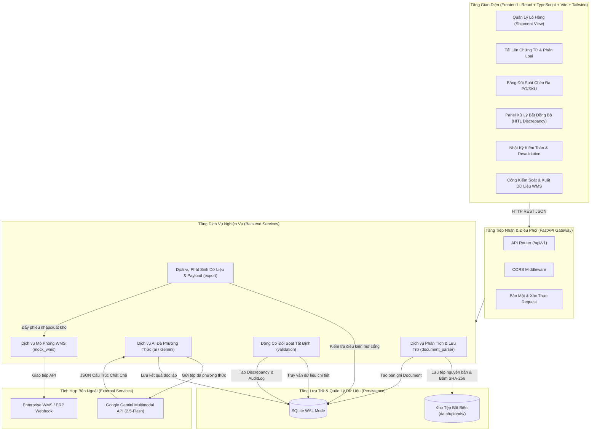
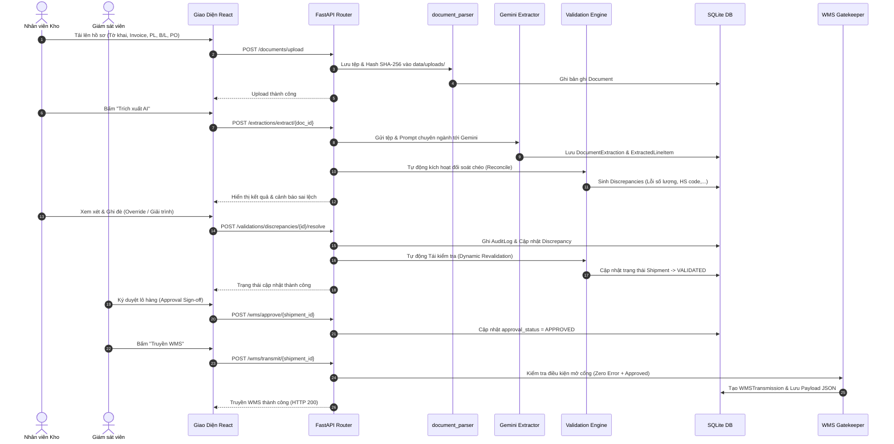

# Kiến Trúc Hệ Thống (System Architecture Document)

## Hệ Thống AI Xử Lý Chứng Từ Kho Ngoại Quan (Vietnamese Bonded Warehouse AI)

---

## 1. Kiến Trúc Tổng Thể (System Architecture Overview)

Hệ thống được thiết kế theo mô hình **Client - Server Decoupled Architecture** (Frontend và Backend phân tách hoàn toàn), hướng dịch vụ mô-đun hóa (Modular Service-Oriented).

---

## 2. Chi Tiết Các Mô-đun Dịch Vụ (Backend Services Breakdown)

### 2.1 `app/services/document_parser/`
- **Chức năng**:
  - Quản lý tệp tải lên an toàn, bảo toàn 100% dữ liệu gốc (Byte-for-byte immutability).
  - Tính toán mã băm SHA-256 xác thực tính toàn vẹn.
  - Phân loại phần mở rộng MIME, hỗ trợ PDF, PNG, JPG, JPEG, TIFF.
  - Quản lý đường dẫn lưu trữ bất biến tại `data/uploads/` bằng định danh UUIDv4.

### 2.2 `app/services/ai/`
- **Chức năng**:
  - Giao tiếp với Google Gemini API thông qua SDK chính thức.
  - Kỹ thuật tạo Prompt nghiệp vụ Hải quan kho ngoại quan Việt Nam.
  - Thực thi kỹ thuật **Pydantic Structured Outputs** (`response_schema`), đảm bảo dữ liệu trả về 100% chuẩn JSON có cấu trúc.
  - Trích xuất độc lập từng chứng từ: Tờ khai hải quan VNACCS, Commercial Invoice, Packing List, Bill of Lading, Purchase Order.

### 2.3 `app/services/validation/`
- **Chức năng**:
  - **100% logic Python tất định (Deterministic Logic)**. AI không bao giờ được dùng để tự đưa ra phán quyết hay tự điều chỉnh số liệu.
  - Kiểm tra toán học dòng hàng ($Qty \times Price == Total$), tổng hóa đơn, tỷ trọng Gross/Net.
  - Đối soát chéo số lượng giữa các chứng từ (Tam giác số lượng: PL vs CI vs Tờ khai).
  - Kiểm tra định dạng chuẩn Mã HS Việt Nam (8 chữ số).
  - Phát hiện xung đột và ghi nhận bản ghi `Discrepancy` ở trạng thái `OPEN`.
  - Hỗ trợ **Dynamic Revalidation**: Khi người dùng chỉnh sửa dữ liệu, dịch vụ chỉ định chạy lại các quy tắc bị ảnh hưởng và cập nhật trạng thái ngay lập tức.

### 2.4 `app/services/export/`
- **Chức năng**:
  - Chuẩn hóa dữ liệu dòng hàng sau khi đối soát thành công thành cấu trúc phiếu nhập kho (`WMSInboundReceiptPayload`) hoặc xuất kho ngoại quan.
  - Xuất dữ liệu đa định dạng: JSON chuẩn WMS, XML tờ khai, bảng tính Excel phục vụ đối soát nghiệp vụ.

### 2.5 `app/services/mock_wms/`
- **Chức năng**:
  - Cổng chặn (`Gatekeeper`): Kiểm tra trạng thái phê duyệt và tồn dư lỗi trước khi truyền dữ liệu.
  - Giả lập hệ thống WMS của doanh nghiệp kho ngoại quan tiếp nhận lệnh nhập/xuất kho và phản hồi mã trạng thái 200/400/422.

---

## 3. Quy Trình Vận Hành Dữ Liệu (Data Flow Lifecycle)

---

## 4. Các Biện Pháp Đảm Bảo Tương Thích Windows 10 Localhost

1. **Đường dẫn tệp**: 100% sử dụng thư viện chuẩn `pathlib.Path`.
2. **Cơ sở dữ liệu SQLite**: Cấu hình chế độ WAL (`PRAGMA journal_mode=WAL`), bật `foreign_keys=ON`, và thiết lập `busy_timeout=5000` để tránh lỗi khóa tệp Windows `WinError 32`.
3. **CORS & Proxy**: Vite thiết lập proxy chuyển tiếp cổng 5173 về 8000 của FastAPI mà không bị xung đột chính sách cùng nguồn gốc (SOP).
