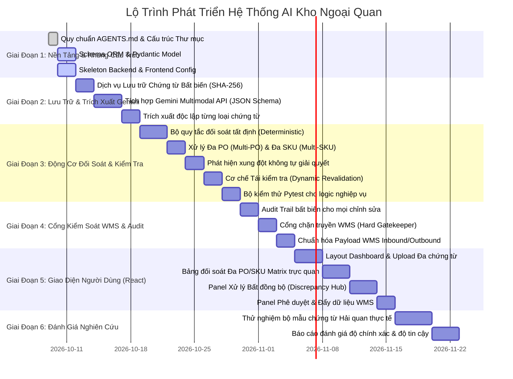

# Kế Hoạch Triển Khai Dự Án (Project Implementation Plan)

**Hệ Thống AI Xử Lý Chứng Từ Kho Ngoại Quan (Vietnamese Bonded Warehouse AI)**  
*Môi trường phát triển: Windows 10 Localhost | Tech Stack: React, TypeScript, Vite, Tailwind CSS, FastAPI, SQLite, SQLAlchemy, Gemini API*

---

## 📅 Lộ Trình Phân Kỳ Thực Hiện (Phased Roadmap)

---

## 🎯 Chi Tiết Từng Giai Đoạn

### Giai Đoạn 1: Thiết Lập Kiến Trúc & Cấu Trúc Khung (Current Phase)
- **Mục tiêu**: Chuẩn hóa toàn bộ quy tắc kỹ thuật (`AGENTS.md`), xây dựng cây thư mục sạch, phân tách frontend/backend, cấu hình môi trường Windows 10.
- **Đầu ra**:
  - `AGENTS.md` hoàn chỉnh.
  - Cây thư mục backend/frontend với đầy đủ `.gitkeep` và file cấu hình (`requirements.txt`, `package.json`, `vite.config.ts`, `tsconfig.json`).
  - Định nghĩa cấu trúc Model (SQLAlchemy) và Schemas (Pydantic).
  - Bản kế hoạch dự án chi tiết.

### Giai Đoạn 2: Lưu Trữ Bất Biến & Trích Xuất Gemini Đích Thực
- **Mục tiêu**: Đảm bảo chứng từ gốc được lưu trữ nguyên bản và sử dụng API Gemini thật với đầu ra JSON định dạng nghiêm ngặt.
- **Tiêu chí hoàn thành**:
  - `StorageService` tính toán băm SHA-256, lưu tệp vào `backend/storage/uploads/` mà không làm biến dạng dữ liệu.
  - `GeminiExtractor` gọi `gemini-2.5-flash` / `gemini-1.5-flash` sử dụng Pydantic Structured Outputs.
  - Kết quả trích xuất của từng chứng từ (Tờ khai, Invoice, Packing List, B/L, PO) được lưu riêng biệt vào bảng `document_extractions`.

### Giai Đoạn 3: Động Cơ Đối Soát Tất Định & Quản Lý Xung Đột
- **Mục tiêu**: Xây dựng thuật toán kiểm tra logic toán học và nghiệp vụ hải quan bằng Python 100% tất định (không dùng AI để phán xét đúng/sai).
- **Tiêu chí hoàn thành**:
  - Triển khai toàn bộ quy tắc `VAL-QTY-001`, `VAL-PRC-001`, `VAL-WGT-001`, `VAL-HS-001`, `VAL-PO-001`, `VAL-CNT-001`.
  - Nhận diện xung đột và tạo bản ghi `Discrepancy` với cờ `severity=ERROR/WARNING`.
  - Nghiêm cấm giải quyết xung đột tự động; bắt buộc người dùng can thiệp.
  - Khi người dùng sửa dữ liệu, hệ thống tự động chạy lại các quy tắc bị ảnh hưởng (Dynamic Revalidation).
  - Viết bộ kiểm thử `pytest` đạt độ bao phủ cao cho module tính toán.

### Giai Đoạn 4: Nhật Ký Kiểm Toán (Audit) & Cổng Chặn WMS
- **Mục tiêu**: Đảm bảo tính toàn vẹn dữ liệu và ngăn chặn việc đẩy dữ liệu chưa chuẩn hóa vào hệ thống quản lý kho (WMS).
- **Tiêu chí hoàn thành**:
  - Bảng `AuditLog` lưu lại mọi thao tác ghi đè (ai sửa, sửa lúc nào, giá trị cũ/mới, lý do).
  - Cổng chặn WMS từ chối (HTTP 422/403) mọi yêu cầu phát sinh payload nếu còn lỗi hoặc chưa có phê duyệt `APPROVED`.

### Giai Đoạn 5: Giao Diện Người Dùng (React + Tailwind CSS)
- **Mục tiêu**: Xây dựng giao diện nghiệp vụ trực quan, mượt mà, thuần tiếng Việt.
- **Tiêu chí hoàn thành**:
  - Giao diện kéo thả chứng từ với thanh tiến trình trích xuất thời gian thực.
  - Bảng đối soát Đa PO / Đa SKU hiển thị chênh lệch số lượng, đơn giá, mã HS nổi bật với màu cảnh báo rõ ràng.
  - Hộp thoại giải quyết sai lệch (Human Override Modal) kèm bắt buộc nhập lý do nghiệp vụ.
  - Nút phê duyệt và xuất dữ liệu WMS (mở khóa khi toàn bộ lỗi được khắc phục).

### Giai Đoạn 6: Đánh Giá Nghiên Cứu Khoa Học & Báo Cáo
- **Mục tiêu**: Thu thập số liệu thực nghiệm phục vụ báo cáo nghiên cứu.
- **Tiêu chí hoàn thành**:
  - Kiểm thử trên bộ hồ sơ hải quan thực tế.
  - Đo lường độ chính xác (Precision, Recall), thời gian xử lý và tỷ lệ phát hiện sai lệch.
